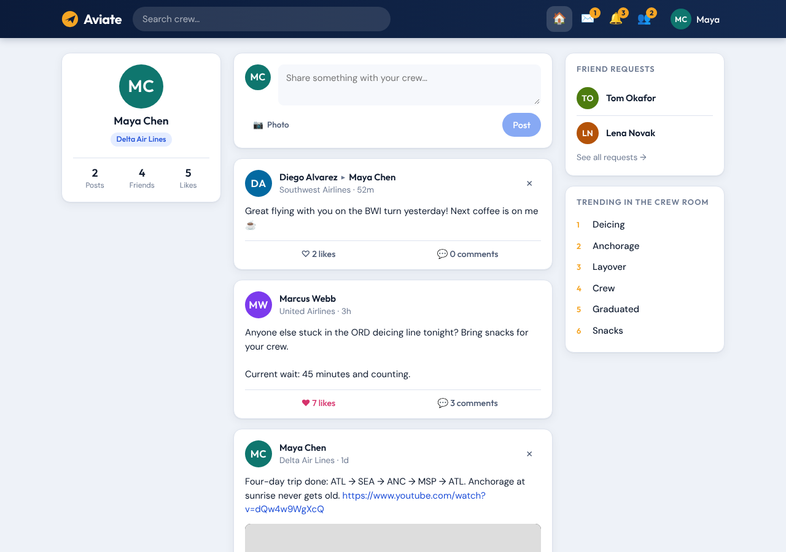
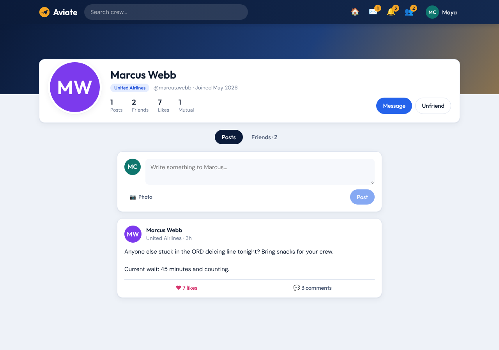
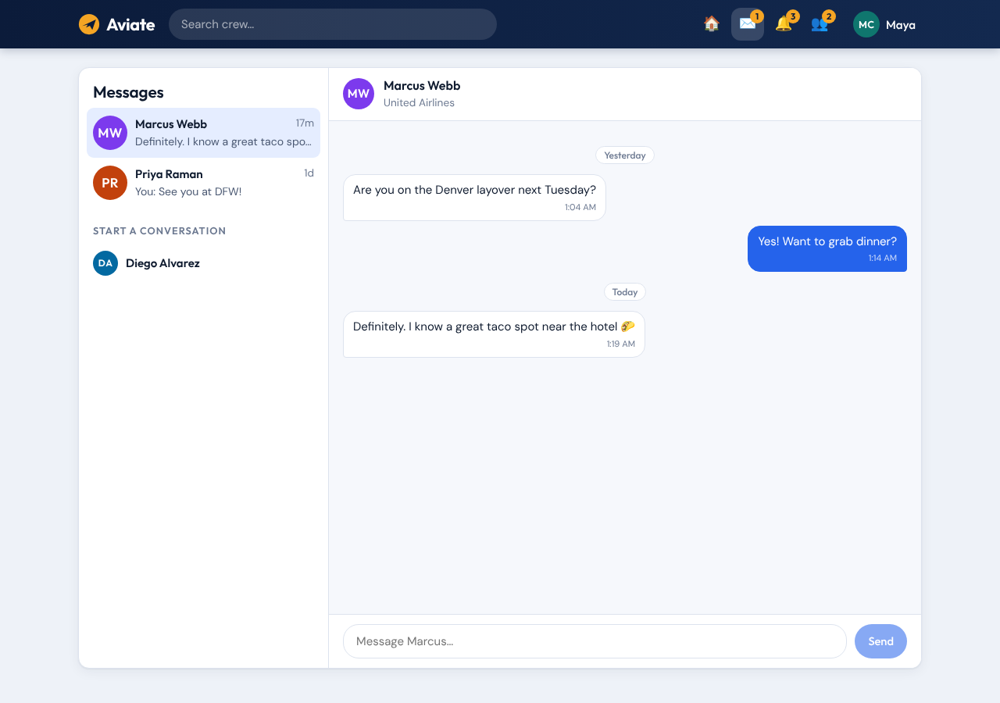
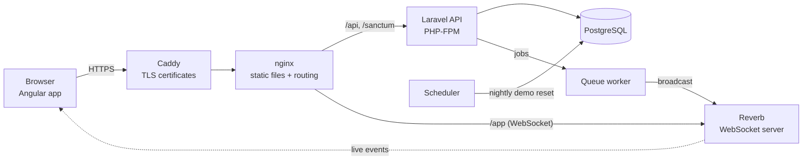
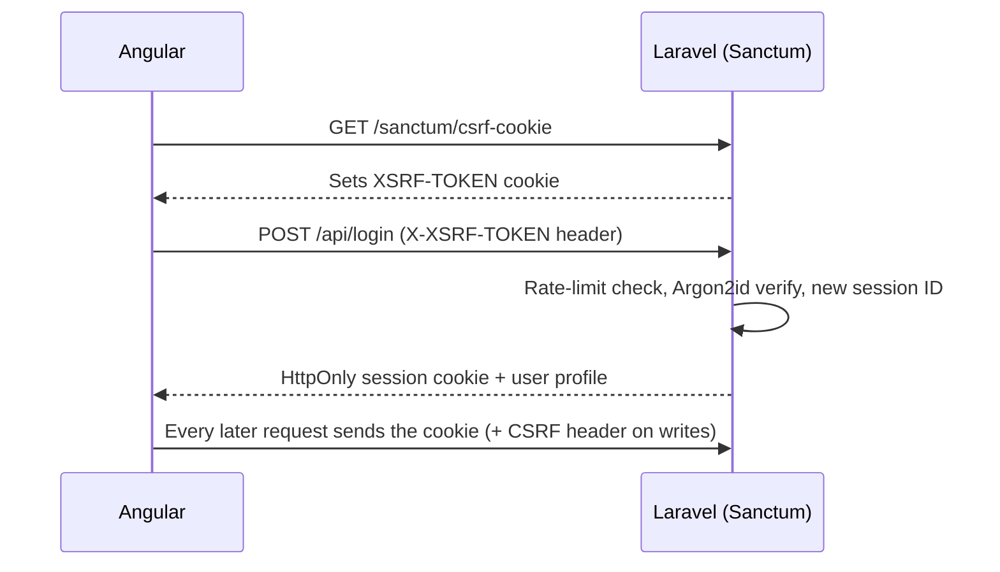
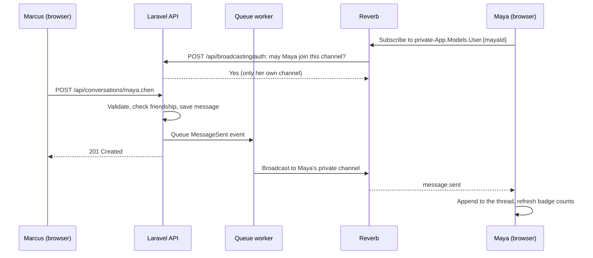
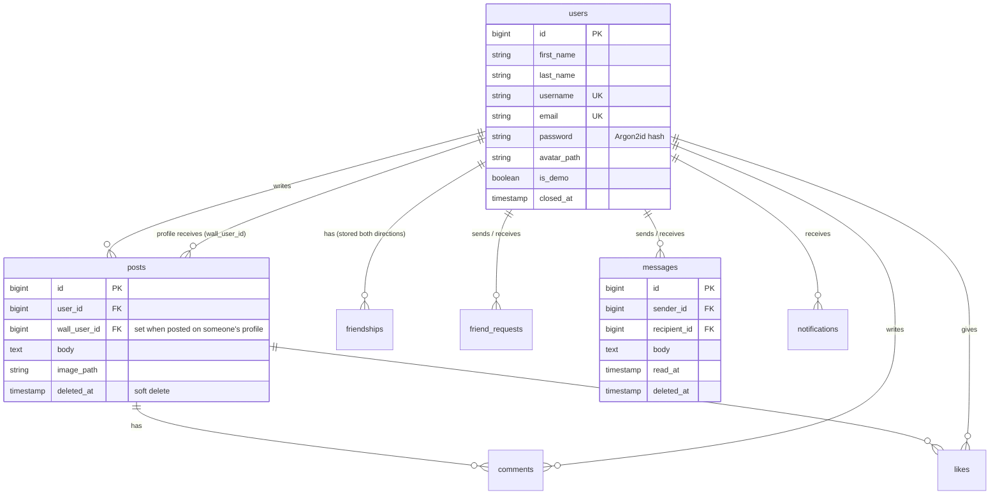

# ✈️ Aviate

**A private social network for airline crews.** Pilots, flight attendants and ground crew sign up with their airline work email, connect with the people they fly with, and share posts, photos, comments and direct messages, all updating live.

**🔗 Live demo: [aviate.glofly.app](https://aviate.glofly.app)**. Click **Try the demo** on the login page; no sign-up needed.



---

## Contents

- [About this project](#about-this-project)
- [Giving a demo](#giving-a-demo)
- [Features](#features)
- [Tech stack](#tech-stack)
- [How it works](#how-it-works)
- [Security](#security)
- [Data model](#data-model)
- [API reference](#api-reference)
- [Running it locally](#running-it-locally)
- [Testing](#testing)
- [Deployment](#deployment)
- [Configuration](#configuration)
- [Project structure](#project-structure)
- [Design decisions](#design-decisions)
- [What I'd build next](#what-id-build-next)

---

## About this project

Aviate started as a PHP social network I built earlier. **The original is here: [github.com/chipmullins/aviate](https://github.com/chipmullins/aviate).** It worked, but it was a classic early LAMP app: procedural PHP pages, hand-built SQL strings, MD5 passwords and jQuery.

**Aviate 2 is a ground-up rebuild** of the same product as a modern single-page application, with an **Angular** front end and a **Laravel** API. I kept the idea and every feature, and rebuilt the architecture with the patterns used in production web apps: a typed API, server-side authorization policies, automated tests, real-time updates over WebSockets, and a containerized deployment behind HTTPS.

| | Original Aviate | Aviate 2 |
|---|---|---|
| Front end | Server-rendered PHP pages + jQuery | **Angular 22** single-page app (standalone components, signals) |
| Back end | Procedural PHP | **Laravel 13** JSON API |
| Database | MySQL, schema not in the repo | **PostgreSQL 17** with versioned migrations |
| Queries | SQL built from strings (SQL-injectable) | Eloquent / query builder with bound parameters |
| Passwords | Unsalted MD5 | **Argon2id** |
| Auth | PHP session, no CSRF protection | Laravel Sanctum cookie sessions + CSRF tokens |
| Permissions | Missing (anyone could delete any post) | Authorization policies on every write, each covered by a test |
| Live updates | None (refresh to see new messages) | **WebSockets** via Laravel Reverb + Echo |
| Uploads | Extension check, `chmod 0777` | Content-checked, re-encoded, EXIF stripped, random names |
| Tests | None | PHPUnit feature tests + Vitest unit tests |
| Deployment | Manual copy to a LAMP server | **Docker Compose** + Caddy (automatic HTTPS) on AWS EC2 |

---

## Giving a demo

A five-minute walkthrough that shows off the main features. Open **[aviate.glofly.app](https://aviate.glofly.app)** in two browser windows: one normal, one private/incognito.

**1. Sign in with one click (window 1)**
On the login page, click **Try the demo → Maya Chen**. She's a Delta flight attendant with friends, posts, a conversation and pending friend requests.
> *Talking point:* demo accounts are real accounts in a demo-mode server. Their settings are locked server-side so one visitor can't lock out the next, and the whole database resets every night.

**2. The feed**
Scroll the feed (it loads more as you scroll), **like** a post, open **comments** and reply. One post contains a YouTube link, which shows as an embedded video.
> *Talking point:* post text is rendered as plain text, never as HTML. Links are only made for `http(s)` URLs, and the YouTube embed is built from a validated 11-character video ID only, so a post can't inject script.

**3. Post something with a photo**
Write a post and attach a photo from your computer.
> *Talking point:* the server decodes and re-encodes every image, which strips EXIF data (including GPS location) and anything hidden in the file, then saves it under a random name.

**4. Profiles and friends**
Click a name to open a **profile**: stats, mutual friends, and posts friends wrote on that profile. Open the **👥** icon to accept or decline Maya's pending friend requests.

**5. Live messaging (the best part)**
In **window 2** (private), click **Try the demo → Marcus Webb**. Send Maya a message from Marcus.
In window 1, the message appears in the conversation **instantly**, and the ✉️ badge updates without a refresh. Like one of Marcus's posts as Maya and watch Marcus's 🔔 badge update live.
> *Talking point:* the API dispatches an event to a queue; a worker pushes it to Reverb (a WebSocket server), which delivers it only to the recipient's private channel. The server checks every channel subscription.

**6. Search and notifications**
Use the search bar at the top (try "pr" or "hannah"), then open the notifications page.

**7. The airline-only rule**
Log out, click **Create an account** and type a Gmail address. The form explains that Aviate is for airline employees only. Try `you@jetblue.com` instead and it's accepted.
> *Talking point:* the browser check is just for convenience. The server enforces an exact-domain allowlist, so `you@notdelta.com` and `you@delta.com.evil.net` are rejected too, and the same rule applies when changing your email later.

**8. Settings**
As Maya, open **Settings**: everything is locked with an explanation. In your own new account, the same page lets you crop and upload a profile photo, change your details and password, or close your account.

**Demo password:** every sample account's password is `aviate-demo-1`, if you'd rather log in through the form.

<details>
<summary><b>All sample accounts</b></summary>

| Name | Email | Airline |
|---|---|---|
| Maya Chen | `maya.chen@delta.com` | Delta Air Lines |
| Marcus Webb | `marcus.webb@united.com` | United Airlines |
| Priya Raman | `priya.raman@aa.com` | American Airlines |
| Diego Alvarez | `diego.alvarez@southwest.com` | Southwest Airlines |
| Hannah Brooks | `hannah.brooks@jetblue.com` | JetBlue |
| Tom Okafor | `tom.okafor@allegiant.com` | Allegiant Air |
| Lena Novak | `lena.novak@suncountry.com` | Sun Country Airlines |

</details>

---

## Features

- **Airline-only sign-up.** Registration and email changes only accept `@united.com`, `@delta.com`, `@aa.com`, `@allegiant.com`, `@suncountry.com`, `@jetblue.com` and `@southwest.com` (exact domain match, configurable).
- **News feed** of your own and your friends' posts, with infinite scroll, photo uploads and YouTube embeds.
- **Profiles** with post, friend and like counts, mutual friends, and posts your friends wrote on your profile.
- **Likes and comments**, with notifications to the post's author (and the profile owner, for profile posts).
- **Friends:** send, cancel, accept and decline requests, and unfriend. Sending a request to someone who already requested you accepts theirs.
- **Direct messages** between friends: live delivery, unread counts, date dividers, deleting your own messages.
- **Live notifications** for likes, comments, profile posts and friend requests, with badge counts in the top bar.
- **Search** by name, with mutual-friend counts and friendship status.
- **Trending words** from recent posts (common words filtered out).
- **Settings:** profile photo with a crop tool, name and email, password change, and closing your account (logging in again reopens it).
- **Responsive design** from phones to wide screens, with keyboard navigation, a skip link and screen-reader labels.
- **Demo mode** for public hosting: one-click sample logins, locked sample accounts and a nightly reset.

<p>
  
  
</p>

---

## Tech stack

| Layer | Technology | Why |
|---|---|---|
| Front end | **Angular 22**, TypeScript, standalone components, **signals**, reactive forms | Typed, component-based SPA; signals keep state simple without extra state libraries |
| Styling | Hand-written SCSS with design tokens; **Outfit** + **DM Sans** fonts | Consistent look without a UI framework's weight |
| Real-time (browser) | **Laravel Echo** + pusher-js | Subscribes to the user's private WebSocket channel |
| API | **Laravel 13** (PHP 8.4) | Routing, validation, Eloquent ORM, policies, notifications, queues, scheduler |
| Auth | **Laravel Sanctum** (SPA mode) | HttpOnly session cookies + CSRF, no tokens in JavaScript |
| Real-time (server) | **Laravel Reverb** | First-party WebSocket server speaking the Pusher protocol |
| Database | **PostgreSQL 17** | Relational data with proper constraints and indexes |
| Web server | **nginx** | Serves the Angular build, routes `/api` to PHP-FPM and `/app` to Reverb, sets security headers |
| HTTPS | **Caddy** | Gets and renews Let's Encrypt certificates automatically |
| Containers | **Docker Compose** | One command runs the whole stack locally or on a server |
| Hosting | **AWS EC2** (t3.micro) + DNS A record | Small, cheap and fully under my control |
| Tests | **PHPUnit** (backend), **Vitest** (front end) | Feature tests through the real HTTP stack; unit tests for parsing and services |

---

## How it works

### Architecture



Everything runs as Docker containers on one server. Only Caddy is reachable from the internet (ports 80/443); the database and PHP are only reachable inside Docker's private network. The browser talks to a **single origin**, so there's no CORS configuration: pages, API calls, uploaded photos and WebSockets all come from `aviate.glofly.app`.

### Signing in



The session lives in an **HttpOnly, encrypted cookie** that JavaScript can't read, so an XSS bug couldn't steal it. Angular's `HttpClient` copies the CSRF cookie into a header on every write automatically. An interceptor fetches a fresh CSRF token and retries once if a token expires (HTTP 419), and sends you to the login page if the session ends (HTTP 401).

### Live updates



Each user has exactly one private channel. Messages and notifications (likes, comments, friend requests) are pushed through it. Broadcasting happens on a **queue worker**, so a slow WebSocket server never slows down the API request that triggered it.

### Uploading a photo

1. Angular checks type and size first (JPG/PNG/WebP, ≤ 5 MB) for a quick error message. For avatars, the user crops to a square in the browser.
2. Laravel validates again on the server: real image content (not just the extension), size, and maximum dimensions (to block "decompression bomb" images).
3. `ImageService` decodes the image with GD, applies the phone's rotation flag, resizes it (posts ≤ 1600 px, avatars 400×400), flattens transparency and **re-encodes it as a fresh JPEG**. This drops EXIF/GPS data and anything smuggled inside the file.
4. The file is saved under a random UUID name in a Docker volume. nginx serves it with `nosniff` and a sandboxing Content-Security-Policy, and refuses anything that isn't an image extension.

### Feeds and pagination

The feed, profile timelines, comments and message threads use **cursor pagination** ("give me 10 posts older than this one"). That stays fast on large tables and never shows duplicates when new posts arrive while scrolling. Angular loads the next page when an `IntersectionObserver` sees the end of the list.

### Demo mode

With `DEMO_MODE=true`:
- `GET /api/demo` tells the login page which sample accounts to offer; `POST /api/demo/login` signs in **only** accounts flagged `is_demo`.
- Any attempt to change a demo account's email, password or photo, or to close it, is refused with `403` by the server. The UI explains why.
- A scheduler container runs `aviate:reset-demo` nightly (4:00 AM Eastern by default). It deletes uploads, rebuilds the database and restores the sample crew. The command refuses to run unless demo mode is on, so it can never wipe a real database.

---

## Security

| Risk | How Aviate handles it |
|---|---|
| **SQL injection** | All queries use Eloquent / the query builder with bound parameters. Search escapes `%` and `_` so they're matched literally. |
| **Password storage** | **Argon2id** (memory-hard; 64 MB and 4 passes per hash). Minimum 8 characters with letters and numbers. |
| **Session theft / CSRF** | Sanctum SPA sessions: HttpOnly, encrypted, `SameSite=Lax`, `Secure` in production. CSRF token required on every write. Session ID regenerated at login. |
| **Brute-force login** | 5 attempts per email + IP per minute, plus per-IP limits on sign-up/login, posting and uploads. |
| **Spoofed client IPs** | Behind Caddy, nginx only trusts the forwarded IP from private Docker addresses, and Caddy overwrites any `X-Forwarded-For` a visitor sends. Rate limits can't be dodged by faking a header. |
| **Account discovery** | Failed logins give the same message whether or not the email exists. |
| **Broken access control** | Laravel policies: only the author or profile owner can delete a post; only the commenter or post author can delete a comment; only the sender can delete a message. You can only message friends, and you only ever see your own conversations and notifications. Each rule has a test. |
| **Cross-site scripting** | Angular escapes all user text; the app never uses `innerHTML`. Strict **Content-Security-Policy**: scripts only from the site itself, frames only from `youtube-nocookie.com`. |
| **Malicious uploads** | Content-checked, size- and dimension-limited, re-encoded, random filenames, served with `nosniff` and a sandbox CSP. |
| **Data exposure** | API resources decide exactly what leaves the server: emails are never included in other users' data. `APP_DEBUG=false` in production, so errors never show stack traces. Closed accounts disappear everywhere. |
| **WebSocket snooping** | Users can only subscribe to their own private channel (checked by the API). Reverb only accepts connections from the site's own host, and its admin API isn't exposed. |
| **Clickjacking and others** | `X-Frame-Options: DENY`, `frame-ancestors 'none'`, `nosniff`, strict referrer policy, Permissions-Policy, HSTS. |
| **Secrets** | `.env` is generated per machine and git-ignored. The database has no public port. |
| **Tests can't touch real data** | Tests run on in-memory SQLite and refuse to start if pointed at any other database. |

---

## Data model



Friendships are stored **twice** (A→B and B→A), so "who are my friends?" is a single indexed lookup instead of an `OR` across two columns. Notifications use Laravel's built-in database notifications, so the same notification class saves the record and broadcasts it live.

---

## API reference

All endpoints are JSON under `/api`. Everything except the first group requires a signed-in session.

<details>
<summary><b>Public</b></summary>

| Method | Endpoint | Purpose |
|---|---|---|
| `POST` | `/register` | Create an account (airline email required) |
| `POST` | `/login` | Sign in |
| `GET` | `/demo` | Demo mode status and sample accounts |
| `POST` | `/demo/login` | One-click sign-in as a sample account (demo mode only) |
| `GET` | `/allowed-domains` | The airline domains allowed to sign up |
| `GET` | `/realtime-config` | The public WebSocket key |

</details>

<details>
<summary><b>Account</b></summary>

| Method | Endpoint | Purpose |
|---|---|---|
| `GET` | `/me` | The signed-in user |
| `GET` | `/me/counts` | Badge counts: friend requests, unread messages, notifications |
| `PUT` | `/me/profile` | Update name and email |
| `PUT` | `/me/password` | Change password (requires the current one) |
| `POST` / `DELETE` | `/me/avatar` | Upload or remove the profile photo |
| `POST` | `/me/close` | Close the account (requires the password) |
| `POST` | `/logout` | Sign out |

</details>

<details>
<summary><b>Posts, comments and likes</b></summary>

| Method | Endpoint | Purpose |
|---|---|---|
| `GET` | `/feed` | News feed (cursor-paginated) |
| `POST` | `/posts` | Create a post (text and/or photo; optional `wall` username) |
| `GET` / `DELETE` | `/posts/{id}` | View or delete a post |
| `GET` / `POST` | `/posts/{id}/comments` | List or add comments |
| `DELETE` | `/comments/{id}` | Delete a comment |
| `POST` / `DELETE` | `/posts/{id}/like` | Like or unlike |

</details>

<details>
<summary><b>People and friends</b></summary>

| Method | Endpoint | Purpose |
|---|---|---|
| `GET` | `/users/{username}` | Profile with stats and friendship status |
| `GET` | `/users/{username}/posts` | Profile timeline |
| `GET` | `/users/{username}/friends` | Friend list |
| `GET` | `/search/users?q=` | Search by name |
| `GET` | `/trends` | Trending words |
| `GET` | `/friend-requests` | Requests waiting for me |
| `POST` | `/users/{username}/friend-request` | Send (or accept, if they asked first) |
| `POST` | `/users/{username}/friend-request/accept` | Accept |
| `DELETE` | `/users/{username}/friend-request` | Cancel or decline |
| `DELETE` | `/users/{username}/friend` | Unfriend |

</details>

<details>
<summary><b>Messages and notifications</b></summary>

| Method | Endpoint | Purpose |
|---|---|---|
| `GET` | `/conversations` | Conversation list with last message and unread count |
| `GET` / `POST` | `/conversations/{username}` | Read a thread (marks it read) or send a message |
| `POST` | `/conversations/{username}/read` | Mark a thread read |
| `DELETE` | `/messages/{id}` | Delete your own message |
| `GET` | `/notifications` | Notifications (paginated) |
| `POST` | `/notifications/{id}/read` | Mark one read |
| `POST` | `/notifications/read-all` | Mark all read |
| `POST` | `/broadcasting/auth` | WebSocket channel authorization (used by Echo) |

</details>

---

## Running it locally

**You need:** [Docker Desktop](https://www.docker.com/products/docker-desktop/) (or Docker Engine with the Compose plugin).

```bash
git clone https://github.com/chipmullins/aviate2.git
cd aviate2
./setup.sh                   # creates .env with random secrets (never overwrites an existing one)
docker compose up --build    # first build takes a few minutes
```

Open **http://localhost:8080** and sign in as `maya.chen@delta.com` / `aviate-demo-1`. To see live messaging, sign in as `marcus.webb@united.com` in a private window and send Maya a message.

On Windows, run `./setup.sh` from Git Bash or WSL, or copy `.env.example` to `.env` and fill in the four secrets yourself.

**Front-end development with hot reload:** keep the Docker stack running, then:

```bash
cd frontend
npm install
npx ng serve      # http://localhost:4200, proxies API and WebSocket calls to :8080
```

| Command | What it does |
|---|---|
| `docker compose up -d` | Start in the background |
| `docker compose logs -f api` | Follow the API's logs |
| `docker compose down` | Stop (keeps data) |
| `docker compose down -v` | Stop and delete all data |

---

## Testing

```bash
# Backend: PHPUnit feature and unit tests (in-memory SQLite, never your real data)
docker compose run --rm api php artisan test

# Front end: Vitest unit tests
cd frontend && npm install && npx ng test --watch=false
```

The backend tests go through the real HTTP stack (routing, middleware, validation, policies, database). They cover:
- **Auth:** registration, the airline-domain rule (including lookalike domains), login, logout, rate limiting, spoofed forwarded-IP headers, closed accounts.
- **Authorization:** who may delete posts, comments and messages; messaging only friends; nobody reading someone else's conversations or notifications; private-channel authorization.
- **Features:** feeds, profiles, friend requests, likes, comments, notifications, search (including `%`/`_` wildcards), settings.
- **Uploads:** re-encoding, resizing, random names, rejecting disguised files.
- **Passwords and demo mode:** Argon2id hashing, demo-only logins, locked demo accounts, the reset command refusing outside demo mode.

Front-end tests cover the safe post-text parser (link and YouTube handling, script-URL rejection), the auth service, error handling and demo mode.

---

## Deployment

The live demo runs on a single **AWS EC2 t3.micro** (Ubuntu 24.04, 1 GB RAM + 2 GB swap) with an Elastic IP and a DNS `A` record for `aviate.glofly.app`. Caddy obtains and renews the HTTPS certificate automatically.

**[DEPLOY.md](DEPLOY.md)** has the full checklist: security group, Elastic IP, DNS, server setup, `.env` settings, troubleshooting and costs (about $13/month).

Updating the live site:

```bash
cd ~/aviate2 && git pull && docker compose up -d --build
```

---

## Configuration

Settings live in `.env` (created by `./setup.sh` from [`.env.example`](.env.example)).

| Setting | Purpose | Local default | Live demo |
|---|---|---|---|
| `APP_KEY`, `DB_PASSWORD`, `REVERB_APP_KEY`, `REVERB_APP_SECRET` | Secrets | generated | generated |
| `APP_URL` | Public address | `http://localhost:8080` | `https://aviate.glofly.app` |
| `SANCTUM_STATEFUL_DOMAINS` | Hosts allowed to use cookie login | `localhost:8080,localhost:4200` | `aviate.glofly.app` |
| `REVERB_ALLOWED_ORIGINS` | Hosts allowed to open WebSockets | `localhost` | `aviate.glofly.app` |
| `SESSION_SECURE_COOKIE` | HTTPS-only cookies | `false` | `true` |
| `COMPOSE_PROFILES` | `https` starts Caddy | none | `https` |
| `AVIATE_DOMAIN` | Domain Caddy gets a certificate for | none | `aviate.glofly.app` |
| `WEB_BIND` | Who can reach nginx directly | `0.0.0.0` | `127.0.0.1` |
| `DEMO_MODE` | One-click demo, locked sample accounts, nightly reset | `false` | `true` |
| `DEMO_RESET_AT` | Nightly reset time (Eastern) | `04:00` | `04:00` |
| `SEED_DEMO_DATA` | Create the sample crew on first start | `true` | `true` |
| `AVIATE_ALLOWED_EMAIL_DOMAINS` | Airline domains allowed to sign up | the seven airlines | same |
| `TRUSTED_PROXIES` | Set to `*` if behind an AWS load balancer | none | none |

---

## Project structure

```
aviate2/
├── docker-compose.yml           # the whole stack: caddy, web, api, queue, reverb, scheduler, db
├── setup.sh                     # creates .env with random secrets
├── DEPLOY.md                    # EC2 + HTTPS deployment checklist
├── deploy/Caddyfile             # HTTPS front door
│
├── backend/                     # Laravel API
│   ├── app/
│   │   ├── Http/Controllers/Api # one controller per area: auth, posts, friends, messages…
│   │   ├── Http/Requests        # validation rules
│   │   ├── Http/Resources       # exactly what JSON leaves the server
│   │   ├── Http/Middleware      # e.g. sign out closed accounts everywhere
│   │   ├── Policies             # who may delete what
│   │   ├── Rules/AirlineEmail   # the airline-domain check
│   │   ├── Services             # image re-encoding, trending words
│   │   ├── Notifications        # likes, comments, friend requests (saved + pushed live)
│   │   ├── Events/MessageSent   # pushed live to the recipient
│   │   └── Console/Commands     # aviate:reset-demo
│   ├── config/aviate.php        # allowed domains, upload limits, demo settings
│   ├── database/                # migrations, factories, demo seeder
│   ├── routes/                  # api.php, channels.php, console.php (scheduler)
│   ├── tests/                   # PHPUnit feature + unit tests
│   └── Dockerfile
│
└── frontend/                    # Angular app
    ├── src/app/core             # typed API client, auth, live updates, badge counts, demo mode
    ├── src/app/shared           # post card, composer, avatar, safe post-text renderer
    ├── src/app/layout           # top bar with search and badges
    ├── src/app/pages            # feed, profile, post, messages, notifications, friends, search, settings, auth
    ├── docker/nginx.conf        # routing + security headers
    └── Dockerfile
```

---

## Design decisions

- **One origin for everything.** nginx serves the app and routes `/api` and `/app` itself, so the browser never makes cross-origin requests. Cookie auth stays simple and safe, and there's no CORS to get wrong.
- **Cookie sessions instead of tokens in the browser.** Sanctum's SPA mode keeps the credential in an HttpOnly cookie, out of reach of JavaScript, rather than storing a bearer token in `localStorage`.
- **API resources as the contract.** Every response goes through a resource class, so adding a column to the database never leaks it by accident. The Angular `models.ts` mirrors these shapes.
- **Authorization in policies, not controllers.** "Who may delete this?" is answered in one place per model, and the API returns `can_delete` so the UI only shows buttons that will work.
- **Broadcast through a queue.** The request that sends a message finishes immediately; a worker delivers it to Reverb. A WebSocket hiccup never fails a user's request.
- **Cursor pagination** for every growing list: constant-time pages and no duplicates while new content arrives.
- **Friendships stored in both directions** for one-index lookups, written inside a transaction so the pair can't get out of sync.
- **Signals in Angular** for component state, with RxJS kept for HTTP and event streams. Most screens need no state library at all.
- **Re-encode every image.** Validating uploads isn't enough; re-encoding guarantees what's stored is just pixels.
- **Demo mode as a feature, not a fork.** The public demo is the same code with one setting switched on, and the server enforces its rules.

---

## What I'd build next

- **Email verification:** a confirmation link proving the person owns their airline address, not just that it has the right domain.
- **CI/CD:** GitHub Actions to run both test suites on every push, build the images, and deploy to EC2 automatically.
- **Redis** for cache, sessions and queues as traffic grows, and S3 for uploaded photos so the app server stays stateless.
- **Group conversations and photo albums.**
- **Moderation tools:** reporting posts and blocking users.
- **End-to-end tests** with Playwright covering the main user journeys.

---

<p align="center">Built by <b>Chip Mullins</b> · Original PHP version: <a href="https://github.com/chipmullins/aviate">chipmullins/aviate</a></p>
