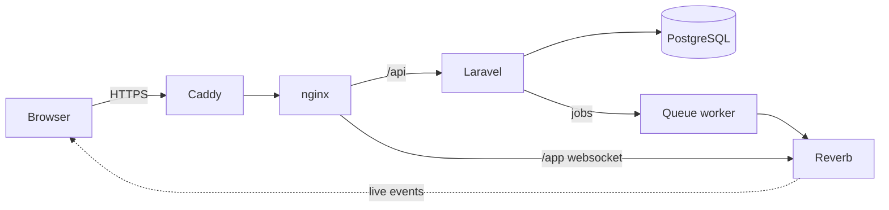

# Aviate


Aviate is a social network for airline employees. You sign up with your airline work email, add the people you fly with, and share posts, photos and messages. Messages and notifications show up live without refreshing.

Live demo: https://aviate.glofly.app (use the "Try the demo" buttons on the login page)


## Background

This is a rebuild of an older project of mine. The original version is at [chipmullins/aviate](https://github.com/chipmullins/aviate). It was a PHP and jQuery app with hand-written SQL, and when I went back to it there was a lot I wanted to fix: queries were open to SQL injection, passwords were stored as MD5 hashes, and any logged-in user could delete anyone's posts.

Instead of patching it, I rebuilt it from scratch with an Angular front end and a Laravel API. The features are the same as the original. Everything underneath is new.

| | Original | Rebuild |
|---|---|---|
| Front end | PHP pages and jQuery | Angular 22 |
| Back end | Procedural PHP | Laravel 13 API |
| Database | MySQL | PostgreSQL 17 with migrations |
| Passwords | MD5 | Argon2id |
| Permissions | None on deletes | Laravel policies |
| Live updates | None | WebSockets (Laravel Reverb) |
| Tests | None | PHPUnit and Vitest |
| Hosting | Manual upload | Docker Compose on AWS EC2 with HTTPS |

## Features

- Sign-up is limited to airline email domains (United, Delta, American, Allegiant, Sun Country, JetBlue, Southwest). The server checks for an exact domain match, so something like `notdelta.com` is rejected.
- A news feed of your posts and your friends' posts, with photos, YouTube embeds and infinite scroll
- Profiles with mutual friends, and friends can post on your profile
- Likes and comments
- Friend requests (send, accept, decline, cancel, unfriend)
- Direct messages between friends, delivered live
- Live notifications and unread badges
- Search by name
- Trending words from recent posts
- Settings: profile photo with cropping, name and email, password, close account

<p>
  
  
</p>

## Trying the demo

The demo site runs with sample accounts. On the login page, click Maya Chen to sign in as her. She has friends, posts, a conversation and a couple of pending friend requests.

To see messaging work live, open a private window and sign in as Marcus Webb. Send Maya a message and it shows up in her window right away.

A few things to try:

- Post something with a photo
- Like or comment on a post, then check the other account's notifications
- Accept one of Maya's friend requests
- Log out and try to register with a Gmail address (it's rejected), then with any made-up airline address like `you@jetblue.com` (it works)

The sample accounts' settings are locked so one visitor can't change the password on everyone else. Everything resets every night at 4 AM Eastern. If you'd rather log in through the form, every sample account uses the password `aviate-demo-1` (for example `maya.chen@delta.com`).

## Stack

- **Front end:** Angular 22 with standalone components and signals, written in TypeScript with hand-written SCSS
- **Back end:** Laravel 13 on PHP 8.4
- **Auth:** Laravel Sanctum, cookie-based sessions with CSRF protection
- **Real-time:** Laravel Reverb on the server, Laravel Echo in the browser
- **Database:** PostgreSQL 17
- **Infrastructure:** nginx, Caddy for HTTPS, Docker Compose, AWS EC2

## How it fits together



Everything runs in Docker on one server. Caddy handles the HTTPS certificate and is the only thing exposed to the internet. nginx serves the Angular build and routes API and WebSocket traffic, so the whole app runs on one domain and I didn't have to deal with CORS.

When someone sends a message, Laravel saves it and puts a broadcast job on the queue. The queue worker sends it to Reverb, which pushes it to the recipient's private channel. Each user can only subscribe to their own channel, and Laravel checks that before Reverb lets them in. Because broadcasting goes through the queue, a slow WebSocket connection never holds up the request that sent the message.

Login uses Sanctum's SPA mode. The session lives in an HttpOnly cookie, so JavaScript never has access to it, and every write request needs a CSRF token. Angular handles the token automatically.

Feeds, comments and message threads use cursor pagination, so scrolling stays fast and doesn't show duplicates when new posts come in.

## Security

These were the main things I wanted to get right this time:

- All database access goes through Eloquent and the query builder, so values are always bound parameters. Search escapes `%` and `_`.
- Passwords are hashed with Argon2id.
- Login is rate limited per email and IP, and there are limits on posting and uploads too.
- Who can delete what is handled by policies: posts by the author or the profile owner, comments by the commenter or the post's author, messages by the sender. You can only message friends.
- Uploaded images are decoded and re-saved as new JPEGs. That strips EXIF data (including GPS location) and anything hidden in the file. They're saved under random names.
- Post text is never rendered as HTML. Links are only created for http and https URLs, and YouTube embeds are built from a validated video ID.
- nginx sends a strict Content-Security-Policy and the usual security headers.
- API responses go through resource classes, so other users' emails are never sent to the browser.

## Running it locally

You'll need Docker Desktop.

```bash
git clone https://github.com/chipmullins/aviate2.git
cd aviate2
./setup.sh
docker compose up --build
```

`setup.sh` creates a `.env` file with random secrets. On Windows, run it from Git Bash or WSL.

Then open http://localhost:8080 and log in as `maya.chen@delta.com` with the password `aviate-demo-1`.

For front-end work with hot reload, leave Docker running and start the Angular dev server:

```bash
cd frontend
npm install
npx ng serve
```

That runs on http://localhost:4200 and proxies API calls to the Docker stack.

## Tests

```bash
docker compose run --rm api php artisan test   # backend
cd frontend && npx ng test --watch=false       # front end
```

The backend tests send real HTTP requests through the API and cover registration and the domain rule, login rate limiting, the delete permissions, messaging between friends only, uploads, notifications, search and the demo mode. They run against an in-memory SQLite database and refuse to start if they're pointed at a real one. The front-end tests cover the post text parser, the auth service and the demo service.

## Deployment

The demo runs on a t3.micro EC2 instance with an Elastic IP and a DNS record for `aviate.glofly.app`. Caddy gets and renews the certificate on its own. Demo mode is turned on with an environment variable, and a scheduled job resets the database every night.

[DEPLOY.md](DEPLOY.md) has the full setup steps. To update the live site:

```bash
git pull && docker compose up -d --build
```

## Project layout

```
backend/     Laravel API: controllers, policies, resources, migrations, tests
frontend/    Angular app, plus the nginx config it's served with
deploy/      Caddyfile
docker-compose.yml
DEPLOY.md
```

## What's next

- Email verification, so having an airline domain isn't enough on its own
- GitHub Actions to run the tests and deploy on every push
- Moving uploads to S3
- Group conversations
- Reporting and blocking
